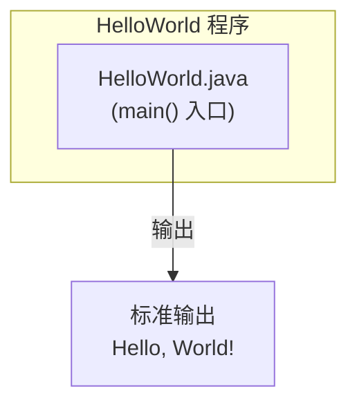

# Step 2: 架构与模块划分

## 功能架构
本程序为单一独立 Java 类，无分层架构，无服务调用，无模块划分。

## 模块清单
| 模块 | 职责 | 依赖 |
|------|------|------|
| HelloWorld | 提供 `main()` 方法，输出 "Hello, World!" | 无（纯 Java SE） |

## 集成架构
本程序不涉及外部系统集成、数据库、缓存或中间件。所有功能均在单 JVM 进程内完成。

**集成关系说明：** 本项不适用 — 无外部系统集成。

## 部署架构
本程序为命令行工具，无需部署架构。用户在本机编译后直接运行即可。

**部署说明：** 本项不适用 — 无服务端部署需求。