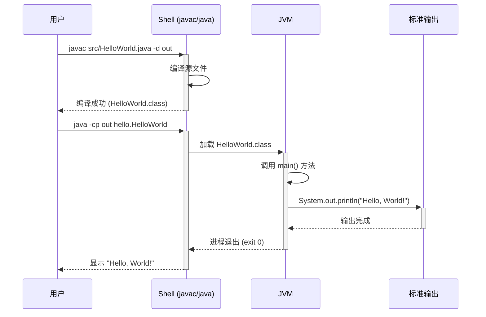

# Step 5: HelloWorld 模块设计

## 5.1 HelloWorld 模块

### 5.1.1 表结构设计
本项不适用 — 本模块无数据库存储需求。

### 5.1.2 枚举与常量定义
本项不适用 — 本模块无枚举/常量定义。

### 5.1.3 接口详细设计
本项不适用 — 本模块无 API 接口。

### 5.1.4 子功能详细设计

#### 5.1.4.1 程序入口与输出（F01, F02）

**处理时序图**

**业务规则：**
| 规则编号 | 规则描述 | 校验时机 | 不满足时的处理 |
|----------|----------|----------|--------------|
| R01 | 编译必须成功 | 编译时 | 返回编译错误信息，需修复源代码 |
| R02 | 输出必须与预期完全一致 | 运行时 | 输出内容与预期不符则需检查代码逻辑 |

**异常场景：**
| 异常场景 | 处理方式 |
|----------|----------|
| JDK 未安装或版本不兼容 | 提示用户安装 JDK，检查 `javac` 和 `java` 命令可用性 |
| 源代码语法错误 | 编译器返回具体错误信息及行号，按提示修复 |
| 类路径配置错误 | 确保 `-cp` 参数指向正确的输出目录 |

**并发控制：** 本项不适用 — 单线程命令行程序，无并发风险。

**状态机设计：** 本项不适用 — 无状态字段。

### 5.1.5 构建脚本（F03）

提供 `build.sh` 脚本，封装编译和运行步骤：
- 创建 `out/` 目录
- 执行 `javac src/HelloWorld.java -d out`
- 执行 `java -cp out hello.HelloWorld`

### 5.1.6 使用说明文档（F04）

提供 `README.md`，包含：
- 前置条件（JDK 安装）
- 构建脚本使用方式（`./build.sh`）
- 手动编译运行步骤
- 预期输出示例

### 5.1.7 模块自检

**完备性对账表：**
| 功能编号 | 功能点 | 是否已设计 | 设计位置 |
|----------|--------|-----------|----------|
| F01 | Java 源文件编写 | ✅ | 5.1.4.1 |
| F02 | 编译与运行验证 | ✅ | 5.1.4.1 |
| F03 | 构建脚本 | ✅ | 5.1.5 |
| F04 | 使用说明文档 | ✅ | 5.1.6 |

**过度设计检查：** ✅ 通过 — 无过度设计，所有功能点均为最小必要实现。