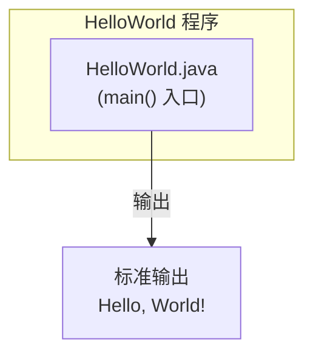
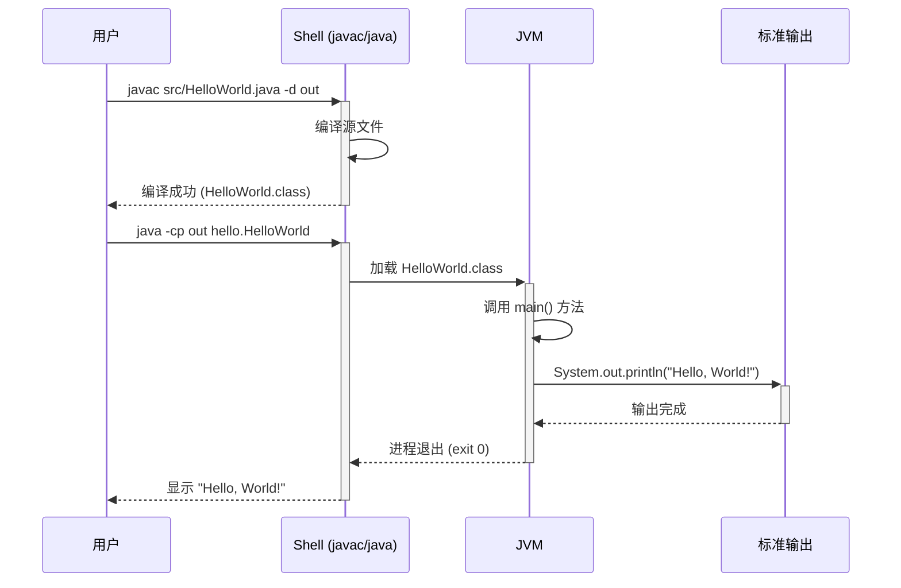

> **文档元信息**
>
> | 项目 | 内容 |
> |------|------|
> | 文档版本 | v1.0 |
> | 作者 | DTCoder |
> | 创建日期 | 2026-08-14 |
> | 需求来源 | `.agents/specs/dima.md`、`.agents/specs/20260814-写个hello world.md` |
> | 评审状态 | 待评审 |

# Hello World 系分设计

## 1. 需求与范围

### 背景与目标
- **项目背景**: 本仓库为马士兵教育（Mashibing Education）的 [InternetArchitect](https://github.com/haikulou1/InternetArchitect) 教学资料仓库，涵盖 Java、Spring、Redis、高并发、微服务等技术栈。
- **需求来源**: 用户需求"写个hello world"，作为初学者的入门示例。
- **目标**: 创建一个最小化的独立 Java Hello World 程序，放置在 `00 HelloWorld/` 目录下，帮助学习者理解 Java 程序的基本结构。

### 核心功能
- 编写一个 Java 类，包含 `main()` 方法
- 输出 `Hello, World!` 到标准输出
- 提供编译和运行说明

### 约束与非功能要求
- 仅使用 Java SE（纯 JDK），无框架依赖
- 必须能用 `javac` 编译通过
- 输出必须精确为 `Hello, World!`

### 排除范围
- 不涉及 Web 框架（Spring Boot 等）
- 不涉及数据库
- 不涉及多模块/多服务架构
- 不涉及任何外部依赖

### 需求功能清单与优先级

| 编号 | 功能点 | 优先级 | PRD 原始描述/章节 | 备注 |
|------|--------|--------|-------------------|------|
| F01 | Java 源文件编写 | P0 | 写个hello world | 创建 HelloWorld.java，含 main() 方法 |
| F02 | 编译与运行验证 | P0 | 写个hello world | 确保程序可编译、可运行，输出 Hello, World! |
| F03 | 构建脚本 | P1 | 写个hello world | 提供 build.sh 简化编译运行流程 |
| F04 | 使用说明文档 | P1 | 写个hello world | README.md 提供编译运行指引 |

### 假设与待确认项

| 编号 | 假设/待确认内容 | 当前假设 | 确认状态 |
|------|-----------------|----------|----------|
| A01 | 仓库中是否已存在 `00 HelloWorld/` 目录？ | 假设不存在，需新建 | 待确认 |
| A02 | Java 版本要求？ | 假设任意 JDK 版本均可（javac/java 命令可用） | 待确认 |
| A03 | 是否需要 package 声明？ | 使用 `package hello;` 便于初学者理解包概念 | 待确认 |
| A04 | 是否需要构建工具（Maven/Gradle）？ | 不需要，仅使用 javac 命令行 | 待确认 |

## 2. 架构与模块

### 功能架构
本程序为单一独立 Java 类，无分层架构，无服务调用，无模块划分。

**模块清单**

| 模块 | 职责 | 依赖 |
|------|------|------|
| HelloWorld | 提供 `main()` 方法，输出 "Hello, World!" | 无（纯 Java SE） |

### 应用集成架构
本程序不涉及外部系统集成、数据库、缓存或中间件。所有功能均在单 JVM 进程内完成。

**集成关系说明：** 本项不适用 — 无外部系统集成。

### 部署架构
本程序为命令行工具，无需部署架构。用户在本机编译后直接运行即可。

**部署说明：** 本项不适用 — 无服务端部署需求。

## 3. 数据模型与存储

### 实体清单
本程序不涉及数据库存储，无实体定义。

**实体清单说明：** 本项不适用 — Hello World 程序无持久化数据需求，无数据库表、无实体关系。

### 实体关系图
本项不适用 — 无实体。

### 缓存/MQ
本项不适用 — 无缓存或消息队列需求。

## 4. 接口设计

### 4.1 oneapi（Web 控制台接口）
本项不适用 — 无 Web 控制台。

### 4.2 OpenAPI（对外接口）
本项不适用 — 无对外 API 接口。

### 4.3 内部接口（Service 层）
本项不适用 — 无 Service 层。

### 4.4 集成接口（Integration 层）
本项不适用 — 无外部系统集成。

## 5. 功能模块设计

### 5.1 HelloWorld 模块

#### 5.1.1 表结构设计
本项不适用 — 本模块无数据库存储需求。

#### 5.1.2 枚举与常量定义
本项不适用 — 本模块无枚举/常量定义。

#### 5.1.3 接口详细设计
本项不适用 — 本模块无 API 接口。

#### 5.1.4 子功能详细设计

##### 5.1.4.1 程序入口与输出（F01, F02）

**处理时序图**

**业务规则：**

| 规则编号 | 规则描述 | 校验时机 | 不满足时的处理 |
|----------|----------|----------|--------------|
| R01 | 编译必须成功 | 编译时 | 返回编译错误信息，需修复源代码 |
| R02 | 输出必须与预期完全一致 | 运行时 | 输出内容与预期不符则需检查代码逻辑 |

**异常场景：**

| 异常场景 | 处理方式 |
|----------|----------|
| JDK 未安装或版本不兼容 | 提示用户安装 JDK，检查 `javac` 和 `java` 命令可用性 |
| 源代码语法错误 | 编译器返回具体错误信息及行号，按提示修复 |
| 类路径配置错误 | 确保 `-cp` 参数指向正确的输出目录 |

**并发控制：** 本项不适用 — 单线程命令行程序，无并发风险。

**状态机设计：** 本项不适用 — 无状态字段。

#### 5.1.5 构建脚本（F03）

提供 `build.sh` 脚本，封装编译和运行步骤：
- 创建 `out/` 目录
- 执行 `javac src/HelloWorld.java -d out`
- 执行 `java -cp out hello.HelloWorld`

#### 5.1.6 使用说明文档（F04）

提供 `README.md`，包含：
- 前置条件（JDK 安装）
- 构建脚本使用方式（`./build.sh`）
- 手动编译运行步骤
- 预期输出示例

#### 5.1.7 模块自检

**完备性对账表：**

| 功能编号 | 功能点 | 是否已设计 | 设计位置 |
|----------|--------|-----------|----------|
| F01 | Java 源文件编写 | ✅ | 5.1.4.1 |
| F02 | 编译与运行验证 | ✅ | 5.1.4.1 |
| F03 | 构建脚本 | ✅ | 5.1.5 |
| F04 | 使用说明文档 | ✅ | 5.1.6 |

**过度设计检查：** ✅ 通过 — 无过度设计，所有功能点均为最小必要实现。

## 6. 非功能性需求设计

### 6.1 高可用性
本项不适用 — 命令行程序，单次运行即退出，无需高可用设计。

### 6.2 可扩展性
本项不适用 — 程序功能单一，无扩展需求。

### 6.3 稳定性/可靠性
本项不适用 — 程序逻辑简单（单行输出），无稳定性风险。

### 6.4 安全性设计
#### 6.4.1 账户系统方案
本项不适用 — 无需用户认证。

#### 6.4.2 授权&访问控制
本项不适用 — 不涉及用户权限管理。

#### 6.4.3 数据防护方案
本项不适用 — 无敏感数据处理。

### 6.5 监控/统计/日志/告警
本项不适用 — 命令行程序，运行即退出，无需监控。

## 7. 变更三板斧

### 7.1 可监控
本项不适用 — 命令行程序，单次运行即退出，无需监控埋点。

### 7.2 可灰度
本项不适用 — 命令行程序，无灰度发布需求。

### 7.3 可应急
本项不适用 — 命令行程序，无在线服务，无需应急开关或回滚方案。