> **文档元信息**
>
> | 项目 | 内容 |
> |------|------|
> | 文档版本 | v1.0 |
> | 作者 | DTCoder |
> | 创建日期 | 2025-07-14 |
> | 需求来源 | `InternetArchitect: 人员看板系统-需求设计文档.md`、`InternetArchitect: .agents/specs/20260814-开发一个人员看板，有入口记录员工的基本信.md` |
> | 评审状态 | 待评审 |

# 人员看板系统 系分设计

## 1. 需求与范围

### 背景与目标

企业需要对内部员工信息进行统一管理与可视化展示。当前缺乏集中化的人员看板系统，员工信息分散在各处，无法高效完成增删改查、批量导入、白名单管理及成本预算统计等操作。

**目标**：构建一个独立的人员看板管理系统，支持：
1. 员工基本信息的增删改查（CRUD）
2. Excel/CSV 批量导入员工数据
3. 白名单标记与管理（核心人才/高管/特殊岗位）
4. 成本预算统计与可视化看板
5. 基于角色的权限控制（管理员/普通用户）

### 核心功能

- 用户认证与权限管理（JWT）
- 员工信息 CRUD（含软删除）
- 批量导入（Excel/CSV，含模板下载、数据校验、错误明细）
- 白名单管理（标记、类型、筛选）
- 成本预算统计（部门汇总、预算对比、趋势图表）
- 看板展示（列表视图 + 卡片视图切换）

### 约束与非功能要求

| 维度 | 要求 |
|------|------|
| 性能 | 列表查询 < 500ms；导入 1000 条 < 30s |
| 安全 | 密码 BCrypt 加密、SQL 注入防护、XSS 防护、敏感数据脱敏 |
| 可用性 | 响应式布局，支持 Chrome/Firefox/Edge 最新两个版本 |
| 可维护 | 代码规范、单元测试覆盖核心逻辑 |
| 数据 | 员工删除采用软删除；导入文件 ≤ 10MB，单次 ≤ 5000 行 |
| 金额精度 | 所有金额字段 DECIMAL(12,2) |

### 排除范围

- 不涉及与外部 HR 系统的集成对接
- 不涉及移动端 App 开发
- 不涉及考勤/排班功能
- 不涉及薪资发放流程

### 需求功能清单与优先级

| 编号 | 功能点 | 优先级 | PRD 原始描述/章节 | 备注 |
|------|--------|--------|-------------------|------|
| F01 | 用户登录/登出 | P0 | 2.1 用户认证与权限 | JWT 认证 |
| F02 | 角色权限控制 | P0 | 2.1 用户认证与权限 | ADMIN/USER 两种角色 |
| F03 | 新增员工 | P0 | 2.2.2 核心功能 | 表单录入 |
| F04 | 编辑员工 | P0 | 2.2.2 核心功能 | 修改员工信息 |
| F05 | 删除员工 | P0 | 2.2.2 核心功能 | 软删除 |
| F06 | 查看员工详情 | P0 | 2.2.2 核心功能 | 完整信息展示 |
| F07 | 员工列表筛选/排序/分页 | P0 | 2.2.2 核心功能 | 多条件筛选 |
| F08 | 批量导入（Excel/CSV） | P0 | 2.3 批量导入 | 含模板下载、校验、错误明细 |
| F09 | 白名单标记与管理 | P1 | 2.4 白名单管理 | 核心人才/高管/特殊岗位 |
| F10 | 部门成本汇总 | P1 | 2.5 成本预算统计 | 按部门汇总人力成本 |
| F11 | 预算对比分析 | P1 | 2.5 成本预算统计 | 实际支出 vs 预算额度 |
| F12 | 成本趋势图表 | P1 | 2.5 成本预算统计 | 折线图、饼图 |
| F13 | 看板视图切换 | P2 | 2.6 看板展示 | 列表视图/卡片视图 |
| F14 | 数据导出 | P2 | 7. 待确认事项 | 假设：需要，导出为 Excel |

### 假设与待确认项

| 编号 | 假设/待确认内容 | 当前假设 | 确认状态 |
|------|-----------------|----------|----------|
| A01 | 是否需要数据导出功能 | 假设需要，支持导出为 Excel/CSV | 待确认 |
| A02 | 是否需要操作日志记录 | 假设需要，记录关键操作日志 | 待确认 |
| A03 | 部署环境 | 假设容器化部署（Docker），单机房 | 待确认 |
| A04 | 是否需要数据备份策略 | 假设采用 MySQL 每日全量 + binlog 增量备份 | 待确认 |
| A05 | 白名单类型是否可扩展 | 假设固定三种：核心人才/高管/特殊岗位，后续可扩展 | 待确认 |
| A06 | 项目汇总维度 | 假设通过技能标签（skills）字段模拟项目归属 | 待确认 |
| A07 | 多租户需求 | 假设单租户模式，无租户隔离需求 | 待确认 |

---

## 2. 架构与模块

### 功能架构

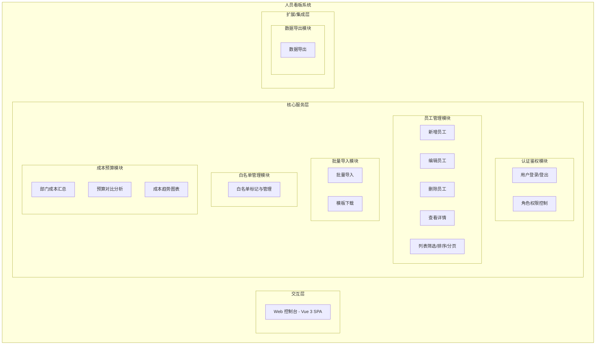

- **交互层**：Vue 3 SPA 单页应用，通过 HTTPS 与后端通信，提供列表视图和卡片视图两种看板展示方式。
- **核心服务层**：Spring Boot 单体应用，包含 5 个业务模块，各模块职责单一、接口清晰。
- **扩展/集成层**：数据导出模块，支持 Excel/CSV 格式导出。

**模块清单**

| 模块 | 职责 | 依赖 |
|------|------|------|
| 认证鉴权模块 | 用户登录/登出、JWT 令牌管理、RBAC 角色权限控制 | 数据库（users 表） |
| 员工管理模块 | 员工信息 CRUD、列表查询、筛选排序分页 | 数据库（employees 表） |
| 批量导入模块 | Excel/CSV 文件解析、数据校验、批量入库、错误明细返回 | 员工管理模块 |
| 白名单管理模块 | 白名单标记、类型管理、白名单筛选 | 员工管理模块 |
| 成本预算模块 | 部门成本汇总、预算对比、趋势图表数据 | 数据库（employees 表、department_budgets 表） |
| 数据导出模块 | 员工数据导出为 Excel/CSV | 员工管理模块 |

### 应用集成架构

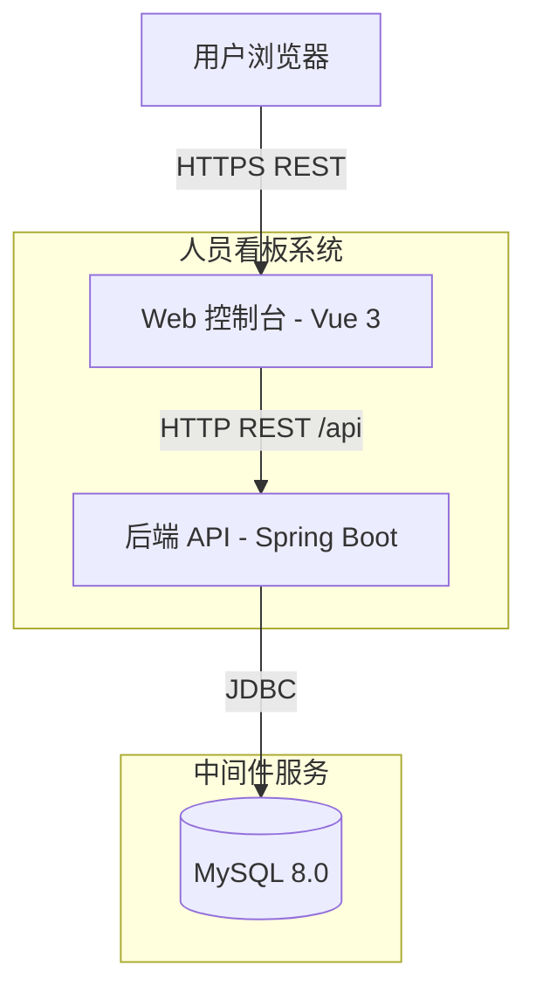

**集成关系说明：**

| 调用方 | 被调用方 | 协议 | 接口类型 | 说明 |
|--------|----------|------|----------|------|
| 用户浏览器 | Web 控制台 | HTTPS | 静态资源 | Vue 3 SPA 静态文件 |
| Web 控制台 | 后端 API | HTTP | oneapi REST | 所有业务接口，统一 `/api/` 前缀 |
| 后端 API | MySQL 数据库 | JDBC | SQL | Spring Data JPA 访问 |

本系统无外部第三方系统集成，部署形态为前后端分离的单体应用。

### 部署架构

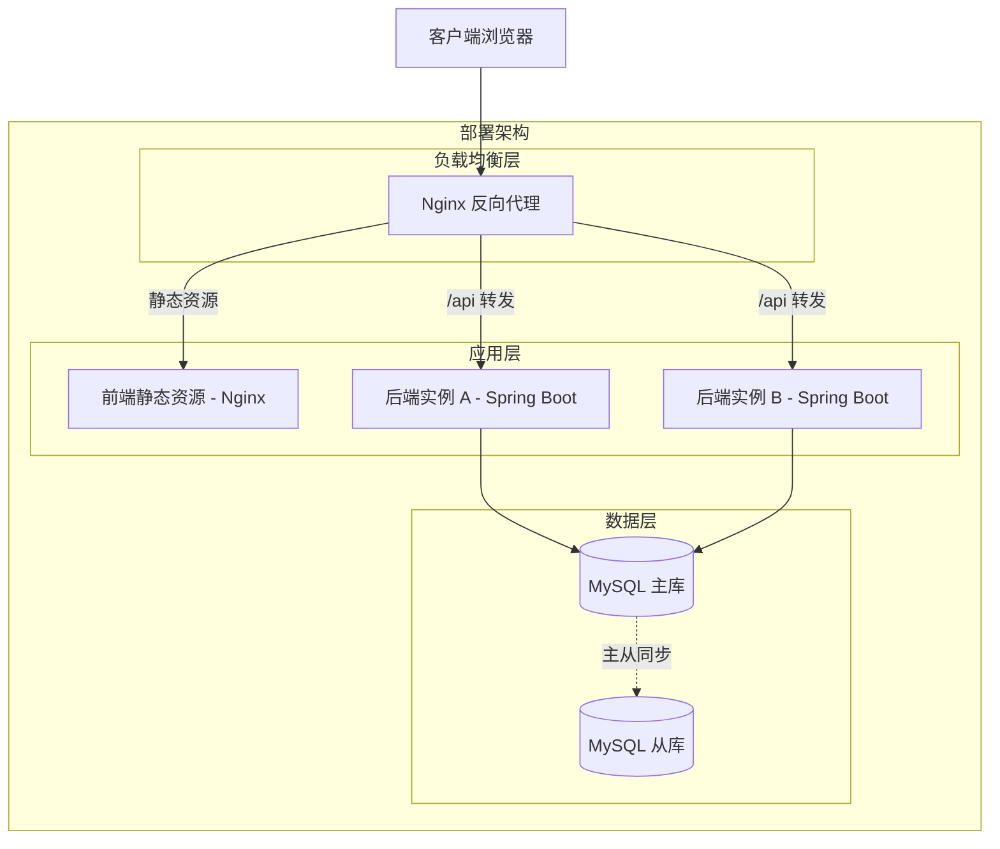

**部署说明：**
- **负载均衡层**：Nginx 反向代理，前端静态资源直接由 Nginx 提供，API 请求轮询转发至后端实例。
- **应用层**：假设至少 2 个后端实例，无状态设计，可水平扩展。前端为纯静态 SPA。
- **数据层**：MySQL 主从架构，主库负责写入，从库可用于只读查询（假设：初期单主库即可，后续按需扩展从库）。
- **假设**：容器化部署（Docker），初期单机房部署。

---

## 3. 数据模型与存储

### 实体清单

| 实体名称 | 实体说明 | 所属模块 | 与其他实体的关系 |
|----------|----------|----------|-----------------|
| User | 系统用户，用于登录认证和权限控制 | 认证鉴权模块 | 一对多关联 Employee（created_by/updated_by） |
| Employee | 员工信息主体，包含基础信息、薪资成本、白名单等 | 员工管理模块 | 多对一关联 User（创建人/更新人） |
| DepartmentBudget | 部门季度预算记录 | 成本预算模块 | 按 department 字段与 Employee 逻辑关联 |
| OperationLog | 操作日志记录 | 认证鉴权模块 | 多对一关联 User（操作人） |

### 实体关系图

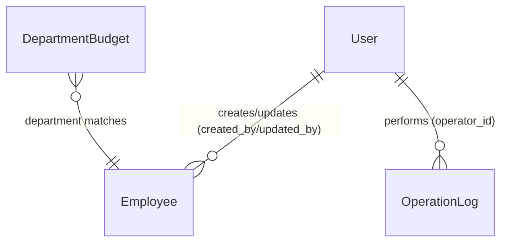

**模型说明：**
- User 与 Employee 之间通过 created_by/updated_by 字段建立审计关联，非外键约束。
- DepartmentBudget 与 Employee 通过 department 字段逻辑关联（非外键），用于成本汇总统计。
- OperationLog 记录关键操作，通过 operator_id 关联操作人。

---

## 4. 接口设计

### 4.1 oneapi（Web 控制台接口）

| 编号 | 接口名称 | 方法 | 路径 | 模块 |
|------|----------|------|------|------|
| W01 | 用户登录 | POST | /api/auth/login | 认证鉴权 |
| W02 | 用户登出 | POST | /api/auth/logout | 认证鉴权 |
| W03 | 获取当前用户信息 | GET | /api/auth/info | 认证鉴权 |
| W04 | 员工列表查询 | GET | /api/employees | 员工管理 |
| W05 | 新增员工 | POST | /api/employees | 员工管理 |
| W06 | 员工详情 | GET | /api/employees/{id} | 员工管理 |
| W07 | 修改员工 | PUT | /api/employees/{id} | 员工管理 |
| W08 | 删除员工 | DELETE | /api/employees/{id} | 员工管理 |
| W09 | 批量导入员工 | POST | /api/employees/import | 批量导入 |
| W10 | 下载导入模板 | GET | /api/employees/template | 批量导入 |
| W11 | 批量设置白名单 | PUT | /api/employees/whitelist | 白名单管理 |
| W12 | 预算汇总统计 | GET | /api/budget/summary | 成本预算 |
| W13 | 部门预算详情 | GET | /api/budget/department/{dept} | 成本预算 |
| W14 | 成本趋势数据 | GET | /api/budget/trend | 成本预算 |
| W15 | 员工数据导出 | GET | /api/employees/export | 数据导出 |

### 4.2 OpenAPI（对外接口）

本系统暂无对外 OpenAPI 接口需求。

### 4.3 内部接口（Service 层）

| 编号 | 接口名称 | 类 | 方法签名 |
|------|----------|------|----------|
| S01 | 认证服务 | AuthService | authenticate(LoginRequest): LoginResponse |
| S02 | 员工查询服务 | EmployeeService | queryEmployees(EmployeeQueryRequest): PageResponse |
| S03 | 员工创建服务 | EmployeeService | createEmployee(EmployeeRequest): EmployeeResponse |
| S04 | 员工更新服务 | EmployeeService | updateEmployee(Long, EmployeeRequest): EmployeeResponse |
| S05 | 员工删除服务 | EmployeeService | deleteEmployee(Long): void |
| S06 | 导入服务 | ImportService | importEmployees(MultipartFile): ImportResultResponse |
| S07 | 白名单服务 | EmployeeService | updateWhitelist(WhitelistRequest): void |
| S08 | 预算汇总服务 | BudgetService | getBudgetSummary(BudgetQueryRequest): BudgetSummaryResponse |
| S09 | 导出服务 | EmployeeService | exportEmployees(EmployeeQueryRequest): byte[] |

### 4.4 集成接口（Integration 层）

本系统无外部系统集成接口。

---

## 5. 功能模块设计

### 全局约定

- **错误码格式**：`{MODULE}_{SEQ}`，如 `AUTH_001`、`EMP_002`、`IMP_001`、`BGT_001`
- **通用出参结构**：`{ code: String, msg: String, data: Object }`
- **分页入参约定**：`pageNum`（页码，从 1 开始）、`pageSize`（每页条数，默认 20，最大 100）
- **时间格式**：`yyyy-MM-dd HH:mm:ss`（日期时间）、`yyyy-MM-dd`（日期）
- **金额格式**：DECIMAL(12,2)，前端展示保留两位小数

**模块映射表**

| 模块前缀 | 错误码前缀 | 表前缀 |
|----------|-----------|--------|
| 认证鉴权 | AUTH_ | sys_ |
| 员工管理 | EMP_ | emp_ |
| 批量导入 | IMP_ | emp_ |
| 白名单管理 | EMP_ | emp_ |
| 成本预算 | BGT_ | bgt_ |
| 数据导出 | EMP_ | emp_ |

---

### 5.1 认证鉴权模块

#### 5.1.1 表结构设计

##### 5.1.1.1 系统用户表（sys_user）

| 字段名 | 数据类型 | 约束 | 默认值 | 说明 |
|--------|----------|------|--------|------|
| id | bigint | PK, 自增 | - | 系统自增主键 |
| username | varchar(50) | NOT NULL, UNIQUE | - | 用户名，登录账号 |
| password | varchar(255) | NOT NULL | - | BCrypt 加密后的密码 |
| role | varchar(20) | NOT NULL | 'USER' | 角色：ADMIN/USER |
| status | tinyint | NOT NULL | 1 | 状态：1-启用 0-禁用 |
| gmt_create | datetime | NOT NULL | CURRENT_TIMESTAMP | 创建时间 |
| gmt_modified | datetime | NOT NULL | CURRENT_TIMESTAMP | 修改时间 |

**索引：**
- UK: `uk_sys_user_username` (username)

##### 5.1.1.2 操作日志表（sys_operation_log）

| 字段名 | 数据类型 | 约束 | 默认值 | 说明 |
|--------|----------|------|--------|------|
| id | bigint | PK, 自增 | - | 系统自增主键 |
| operator_id | bigint | NOT NULL | - | 操作人 ID |
| operation | varchar(50) | NOT NULL | - | 操作类型：LOGIN/LOGOUT/CREATE/UPDATE/DELETE/IMPORT/EXPORT |
| target_type | varchar(50) | - | - | 操作对象类型：EMPLOYEE/BUDGET 等 |
| target_id | bigint | - | - | 操作对象 ID |
| detail | varchar(500) | - | - | 操作详情描述 |
| ip | varchar(50) | - | - | 操作 IP 地址 |
| gmt_create | datetime | NOT NULL | CURRENT_TIMESTAMP | 操作时间 |

**索引：**
- IDX: `idx_sys_oplog_operator` (operator_id)
- IDX: `idx_sys_oplog_time` (gmt_create)

##### 5.1.1.3 枚举与常量定义

| 枚举名称 | 取值 | 含义 | 关联字段 |
|----------|------|------|----------|
| UserRole | ADMIN | 管理员，拥有全部权限 | sys_user.role |
| UserRole | USER | 普通用户，仅查看+导入 | sys_user.role |
| UserStatus | 1 | 启用 | sys_user.status |
| UserStatus | 0 | 禁用 | sys_user.status |
| OperationType | LOGIN | 登录 | sys_operation_log.operation |
| OperationType | LOGOUT | 登出 | sys_operation_log.operation |
| OperationType | CREATE | 新增 | sys_operation_log.operation |
| OperationType | UPDATE | 修改 | sys_operation_log.operation |
| OperationType | DELETE | 删除 | sys_operation_log.operation |
| OperationType | IMPORT | 导入 | sys_operation_log.operation |
| OperationType | EXPORT | 导出 | sys_operation_log.operation |

#### 5.1.2 接口详细设计

##### W01 用户登录

- **URI**: POST /api/auth/login
- **描述**: 用户通过用户名密码登录，返回 JWT 令牌
- **入参**:

| 参数名称 | 类型 | 是否必填 | 描述 |
|----------|------|----------|------|
| username | String | 是 | 用户名 |
| password | String | 是 | 密码（明文传输，HTTPS 保障） |

- **出参**:

| 参数名称 | 类型 | 描述 |
|----------|------|------|
| code | String | 结果码 |
| msg | String | 提示信息 |
| data.token | String | JWT 令牌 |
| data.expiresIn | Long | 令牌过期时间（秒） |

- **错误码**:

| 错误码 | 说明 |
|--------|------|
| AUTH_001 | 用户名或密码错误 |
| AUTH_002 | 账户已被禁用 |

- **请求示例**:
```json
{
  "username": "admin",
  "password": "123456"
}
```

- **响应示例**:
```json
{
  "code": "OK",
  "msg": "SUCCESS",
  "data": {
    "token": "eyJhbGciOiJIUzI1NiJ9...",
    "expiresIn": 86400
  }
}
```

##### W02 用户登出

- **URI**: POST /api/auth/logout
- **描述**: 用户登出，服务端将令牌加入黑名单（假设：采用 JWT + Redis 黑名单方案，或简单方案下前端清除令牌即可）
- **入参**: 无（通过 Header Authorization 携带 token）
- **出参**:

| 参数名称 | 类型 | 描述 |
|----------|------|------|
| code | String | 结果码 |
| msg | String | 提示信息 |

- **错误码**: 无特殊错误码

##### W03 获取当前用户信息

- **URI**: GET /api/auth/info
- **描述**: 根据 JWT 令牌获取当前登录用户信息
- **入参**: 无（通过 Header Authorization 携带 token）
- **出参**:

| 参数名称 | 类型 | 描述 |
|----------|------|------|
| code | String | 结果码 |
| msg | String | 提示信息 |
| data.id | Long | 用户 ID |
| data.username | String | 用户名 |
| data.role | String | 角色 |

- **错误码**:

| 错误码 | 说明 |
|--------|------|
| AUTH_003 | 令牌无效或已过期 |

#### 5.1.3 子功能详细设计

##### 5.1.3.1 用户登录（F01）

- 处理时序图
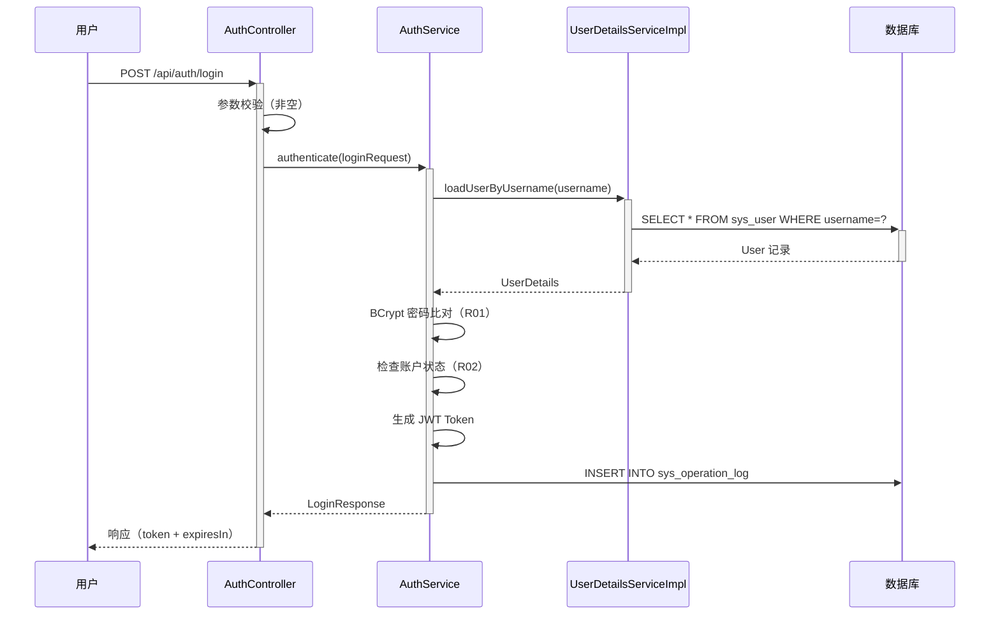

**业务规则：**

| 规则编号 | 规则描述 | 校验时机 | 不满足时的处理 |
|----------|----------|----------|--------------|
| R01 | 用户名必须存在且密码匹配 | 登录时 | 返回 AUTH_001 |
| R02 | 账户状态必须为启用（status=1） | 登录时 | 返回 AUTH_002 |
| R03 | JWT 令牌有效期 24 小时 | 生成时 | - |

**异常场景：**

| 异常场景 | 处理方式 |
|----------|----------|
| 数据库连接异常 | 返回系统错误，提示"服务暂时不可用" |
| 连续登录失败 5 次 | 假设：暂不实现账户锁定，后续可扩展 |

**并发控制：**
- 并发场景：同一用户多端同时登录
- 控制策略：无并发风险，每次登录生成独立 JWT，互不影响

---

### 5.2 员工管理模块

#### 5.2.1 表结构设计

##### 5.2.1.1 员工信息表（emp_employee）

| 字段名 | 数据类型 | 约束 | 默认值 | 说明 |
|--------|----------|------|--------|------|
| id | bigint | PK, 自增 | - | 系统自增主键 |
| employee_no | varchar(50) | NOT NULL, UNIQUE | - | 工号，唯一标识 |
| name | varchar(100) | NOT NULL | - | 姓名 |
| gender | tinyint | - | - | 性别：1-男 2-女 |
| phone | varchar(20) | - | - | 手机号 |
| email | varchar(100) | - | - | 邮箱 |
| department | varchar(100) | - | - | 部门 |
| position | varchar(100) | - | - | 职位 |
| hire_date | date | - | - | 入职日期 |
| avatar | varchar(255) | - | - | 头像 URL |
| education | varchar(50) | - | - | 学历 |
| hometown | varchar(100) | - | - | 籍贯 |
| skills | varchar(500) | - | - | 技能标签，逗号分隔 |
| remarks | text | - | - | 备注 |
| status | varchar(20) | NOT NULL | 'PROBATION' | 在职状态 |
| contract_start | date | - | - | 合同开始日期 |
| contract_end | date | - | - | 合同结束日期 |
| emergency_contact | varchar(100) | - | - | 紧急联系人 |
| emergency_phone | varchar(20) | - | - | 紧急联系人电话 |
| base_salary | decimal(12,2) | - | 0 | 基本工资 |
| social_security | decimal(12,2) | - | 0 | 社保 |
| housing_fund | decimal(12,2) | - | 0 | 公积金 |
| allowance | decimal(12,2) | - | 0 | 岗位津贴 |
| annual_budget | decimal(12,2) | - | 0 | 年度预算额度 |
| is_whitelist | tinyint | NOT NULL | 0 | 是否白名单：0-否 1-是 |
| whitelist_type | varchar(50) | - | - | 白名单类型 |
| is_deleted | tinyint | NOT NULL | 0 | 软删除标记：0-正常 1-已删除 |
| gmt_create | datetime | NOT NULL | CURRENT_TIMESTAMP | 创建时间 |
| gmt_modified | datetime | NOT NULL | CURRENT_TIMESTAMP | 修改时间 |
| created_by | bigint | - | - | 创建人 ID |
| updated_by | bigint | - | - | 修改人 ID |

**索引：**
- UK: `uk_emp_employee_no` (employee_no)
- IDX: `idx_emp_employee_dept` (department)
- IDX: `idx_emp_employee_status` (status)
- IDX: `idx_emp_employee_whitelist` (is_whitelist)
- IDX: `idx_emp_employee_name` (name)

##### 5.2.1.2 枚举与常量定义

| 枚举名称 | 取值 | 含义 | 关联字段 |
|----------|------|------|----------|
| EmployeeStatus | REGULAR | 正式在职 | emp_employee.status |
| EmployeeStatus | PROBATION | 试用期 | emp_employee.status |
| EmployeeStatus | RESIGNED | 已离职 | emp_employee.status |
| Gender | 1 | 男 | emp_employee.gender |
| Gender | 2 | 女 | emp_employee.gender |
| WhitelistType | CORE_TALENT | 核心人才 | emp_employee.whitelist_type |
| WhitelistType | EXECUTIVE | 高管 | emp_employee.whitelist_type |
| WhitelistType | SPECIAL | 特殊岗位 | emp_employee.whitelist_type |

#### 5.2.2 接口详细设计

##### W04 员工列表查询

- **URI**: GET /api/employees
- **描述**: 分页查询员工列表，支持多条件筛选和排序
- **入参**:

| 参数名称 | 类型 | 是否必填 | 描述 |
|----------|------|----------|------|
| pageNum | Integer | 否 | 页码，默认 1 |
| pageSize | Integer | 否 | 每页条数，默认 20 |
| name | String | 否 | 姓名模糊搜索 |
| department | String | 否 | 部门精确筛选 |
| status | String | 否 | 在职状态筛选 |
| isWhitelist | Integer | 否 | 白名单筛选：0/1 |
| sortField | String | 否 | 排序字段 |
| sortOrder | String | 否 | 排序方向：asc/desc |

- **出参**:

| 参数名称 | 类型 | 描述 |
|----------|------|------|
| code | String | 结果码 |
| msg | String | 提示信息 |
| data.total | Long | 总记录数 |
| data.list | Array | 员工列表 |
| data.list[].id | Long | 员工 ID |
| data.list[].employeeNo | String | 工号 |
| data.list[].name | String | 姓名 |
| data.list[].department | String | 部门 |
| data.list[].position | String | 职位 |
| data.list[].status | String | 在职状态 |
| data.list[].isWhitelist | Integer | 是否白名单 |

- **错误码**: 无特殊错误码

##### W05 新增员工

- **URI**: POST /api/employees
- **描述**: 新增一条员工记录
- **入参**:

| 参数名称 | 类型 | 是否必填 | 描述 |
|----------|------|----------|------|
| employeeNo | String | 是 | 工号，唯一 |
| name | String | 是 | 姓名 |
| gender | Integer | 否 | 性别：1-男 2-女 |
| phone | String | 否 | 手机号 |
| email | String | 否 | 邮箱 |
| department | String | 否 | 部门 |
| position | String | 否 | 职位 |
| hireDate | String | 否 | 入职日期 yyyy-MM-dd |
| education | String | 否 | 学历 |
| hometown | String | 否 | 籍贯 |
| skills | String | 否 | 技能标签 |
| remarks | String | 否 | 备注 |
| status | String | 否 | 在职状态，默认 PROBATION |
| contractStart | String | 否 | 合同开始日期 |
| contractEnd | String | 否 | 合同结束日期 |
| emergencyContact | String | 否 | 紧急联系人 |
| emergencyPhone | String | 否 | 紧急联系人电话 |
| baseSalary | BigDecimal | 否 | 基本工资 |
| socialSecurity | BigDecimal | 否 | 社保 |
| housingFund | BigDecimal | 否 | 公积金 |
| allowance | BigDecimal | 否 | 岗位津贴 |
| annualBudget | BigDecimal | 否 | 年度预算额度 |
| isWhitelist | Integer | 否 | 是否白名单 |
| whitelistType | String | 否 | 白名单类型 |

- **出参**:

| 参数名称 | 类型 | 描述 |
|----------|------|------|
| code | String | 结果码 |
| msg | String | 提示信息 |
| data.id | Long | 新建员工 ID |

- **错误码**:

| 错误码 | 说明 |
|--------|------|
| EMP_001 | 工号已存在 |
| EMP_002 | 手机号格式不正确 |
| EMP_003 | 邮箱格式不正确 |

- **请求示例**:
```json
{
  "employeeNo": "EMP001",
  "name": "张三",
  "gender": 1,
  "phone": "13800138000",
  "department": "技术部",
  "position": "高级工程师",
  "status": "REGULAR"
}
```

- **响应示例**:
```json
{
  "code": "OK",
  "msg": "SUCCESS",
  "data": {
    "id": 1
  }
}
```

##### W06 员工详情

- **URI**: GET /api/employees/{id}
- **描述**: 获取员工完整信息
- **入参**:

| 参数名称 | 类型 | 是否必填 | 描述 |
|----------|------|----------|------|
| id | Long | 是 | 员工 ID（路径参数） |

- **出参**: 完整员工信息对象（同 W05 入参所有字段 + id + gmtCreate + gmtModified）

- **错误码**:

| 错误码 | 说明 |
|--------|------|
| EMP_004 | 员工不存在 |

##### W07 修改员工

- **URI**: PUT /api/employees/{id}
- **描述**: 修改员工信息
- **入参**: 同 W05（id 为路径参数，其余字段可选更新）
- **出参**:

| 参数名称 | 类型 | 描述 |
|----------|------|------|
| code | String | 结果码 |
| msg | String | 提示信息 |

- **错误码**:

| 错误码 | 说明 |
|--------|------|
| EMP_004 | 员工不存在 |
| EMP_001 | 工号已存在（修改工号时） |

##### W08 删除员工

- **URI**: DELETE /api/employees/{id}
- **描述**: 软删除员工（设置 is_deleted=1）
- **入参**:

| 参数名称 | 类型 | 是否必填 | 描述 |
|----------|------|----------|------|
| id | Long | 是 | 员工 ID（路径参数） |

- **出参**:

| 参数名称 | 类型 | 描述 |
|----------|------|------|
| code | String | 结果码 |
| msg | String | 提示信息 |

- **错误码**:

| 错误码 | 说明 |
|--------|------|
| EMP_004 | 员工不存在 |

##### W11 批量设置白名单

- **URI**: PUT /api/employees/whitelist
- **描述**: 批量设置员工的白名单状态
- **入参**:

| 参数名称 | 类型 | 是否必填 | 描述 |
|----------|------|----------|------|
| ids | Array\<Long\> | 是 | 员工 ID 列表 |
| isWhitelist | Integer | 是 | 是否白名单：0/1 |
| whitelistType | String | 否 | 白名单类型（isWhitelist=1 时必填） |

- **出参**:

| 参数名称 | 类型 | 描述 |
|----------|------|------|
| code | String | 结果码 |
| msg | String | 提示信息 |

- **错误码**:

| 错误码 | 说明 |
|--------|------|
| EMP_005 | 批量操作数量超限（单次最多 100 条） |

#### 5.2.3 子功能详细设计

##### 5.2.3.1 新增员工（F03）

- 处理时序图
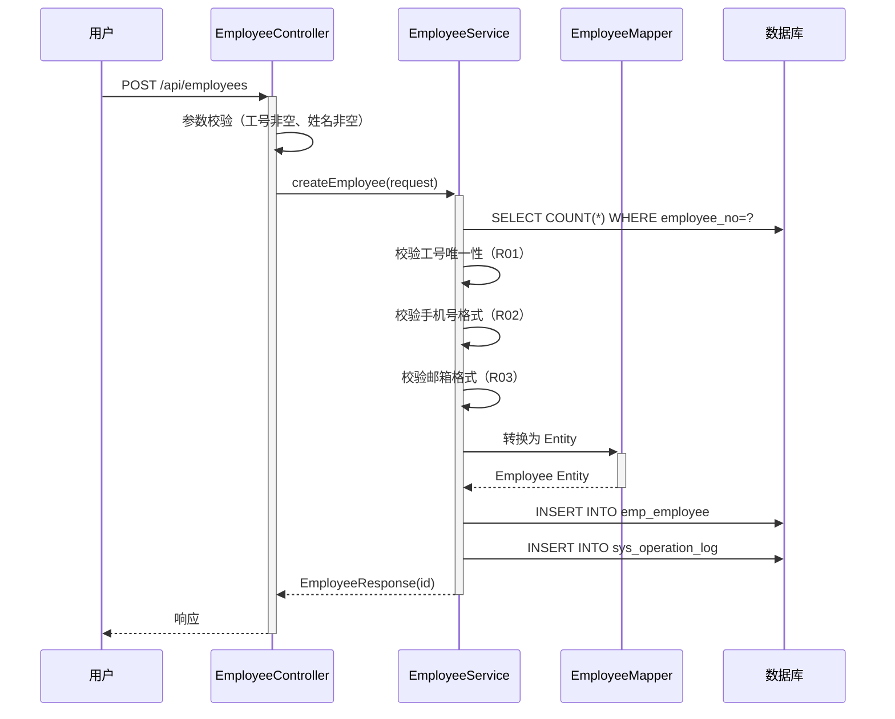

**业务规则：**

| 规则编号 | 规则描述 | 校验时机 | 不满足时的处理 |
|----------|----------|----------|--------------|
| R01 | 工号必须唯一 | 创建时 | 返回 EMP_001 |
| R02 | 手机号格式：11 位数字 | 创建时 | 返回 EMP_002 |
| R03 | 邮箱格式：标准邮箱正则 | 创建时 | 返回 EMP_003 |
| R04 | 姓名不能为空 | 创建时 | 返回参数校验错误 |
| R05 | 白名单类型为白名单时必填 | 创建时 | 返回参数校验错误 |

**异常场景：**

| 异常场景 | 处理方式 |
|----------|----------|
| 数据库唯一约束冲突 | 捕获异常，返回 EMP_001 |
| 数据库连接异常 | 返回系统错误 |

**并发控制：**
- 并发场景：两人同时新增相同工号的员工
- 控制策略：数据库唯一约束兜底 + 应用层先查后插。极端并发下由数据库唯一约束保证，捕获 DuplicateKeyException 返回 EMP_001。

##### 5.2.3.2 删除员工（F05）

- 处理时序图
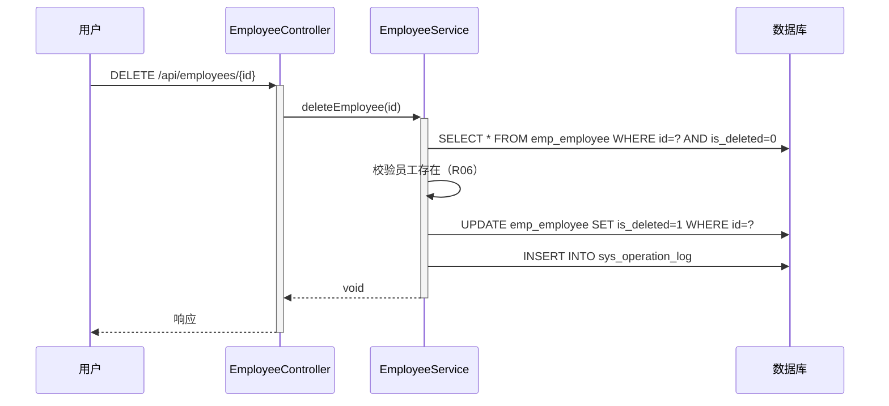

**业务规则：**

| 规则编号 | 规则描述 | 校验时机 | 不满足时的处理 |
|----------|----------|----------|--------------|
| R06 | 员工必须存在且未删除 | 删除前 | 返回 EMP_004 |

**并发控制：**
- 并发场景：多人同时删除同一员工
- 控制策略：软删除操作幂等，多次删除结果一致，无并发风险。

##### 5.2.3.3 员工状态机（F03/F04）

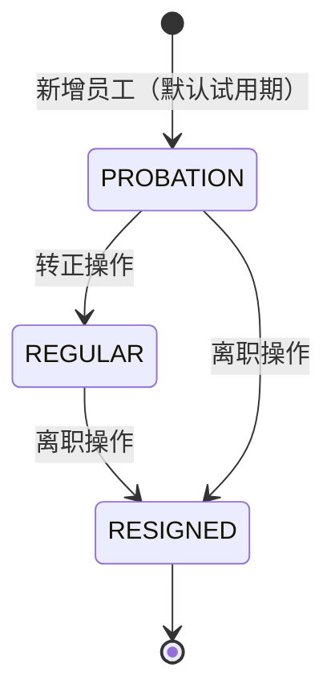

**状态流转规则：**

| 当前状态 | 目标状态 | 流转条件 | 前置校验 | 触发动作 |
|----------|----------|----------|----------|----------|
| [*] | PROBATION | 新增员工 | 工号唯一 | 创建员工记录 |
| PROBATION | REGULAR | 编辑状态为 REGULAR | 员工存在 | 更新状态字段 |
| PROBATION | RESIGNED | 编辑状态为 RESIGNED | 员工存在 | 更新状态字段 |
| REGULAR | RESIGNED | 编辑状态为 RESIGNED | 员工存在 | 更新状态字段 |

---

### 5.3 批量导入模块

#### 5.3.1 表结构设计

本模块复用 emp_employee 表，无新增表。

导入记录通过 sys_operation_log 记录，operation=IMPORT。

##### 5.3.1.2 枚举与常量定义

| 枚举名称 | 取值 | 含义 | 关联字段 |
|----------|------|------|----------|
| ImportFormat | XLSX | Excel 2007+ 格式 | 文件格式判断 |
| ImportFormat | XLS | Excel 97-2003 格式 | 文件格式判断 |
| ImportFormat | CSV | CSV 文本格式 | 文件格式判断 |

#### 5.3.2 接口详细设计

##### W09 批量导入员工

- **URI**: POST /api/employees/import
- **描述**: 上传 Excel/CSV 文件批量导入员工数据
- **入参**:

| 参数名称 | 类型 | 是否必填 | 描述 |
|----------|------|----------|------|
| file | MultipartFile | 是 | Excel(.xlsx/.xls) 或 CSV 文件 |

- **出参**:

| 参数名称 | 类型 | 描述 |
|----------|------|------|
| code | String | 结果码 |
| msg | String | 提示信息 |
| data.totalCount | Integer | 文件总行数 |
| data.successCount | Integer | 成功导入数 |
| data.failCount | Integer | 失败数 |
| data.errors | Array | 错误明细列表 |
| data.errors[].row | Integer | 行号 |
| data.errors[].field | String | 错误字段 |
| data.errors[].message | String | 错误描述 |

- **错误码**:

| 错误码 | 说明 |
|--------|------|
| IMP_001 | 文件格式不支持 |
| IMP_002 | 文件大小超过 10MB |
| IMP_003 | 数据行数超过 5000 行 |
| IMP_004 | 文件内容为空 |

- **业务规则**: 采用"全部校验后部分导入"策略——先全量校验，校验通过的记录入库，校验失败的记录返回错误明细。

##### W10 下载导入模板

- **URI**: GET /api/employees/template
- **描述**: 下载标准 Excel 导入模板
- **入参**: 无
- **出参**: Excel 文件流（Content-Type: application/vnd.openxmlformats-officedocument.spreadsheetml.sheet）

#### 5.3.3 子功能详细设计

##### 5.3.3.1 批量导入（F08）

- 处理时序图
```mermaid
sequenceDiagram
    participant C as 用户
    participant Ctrl as EmployeeController
    participant Svc as ImportService
    participant EmpSvc as EmployeeService
    participant Parser as FileParser
    participant DB as 数据库

    C->>+Ctrl: POST /api/employees/import (file)
    Ctrl->>Ctrl: 校验文件格式和大小（R07/R08）
    Ctrl->>+Svc: importEmployees(file)
    Svc->>+Parser: parse(file)
    Parser-->>-Svc: List<Map<String, String>>
    Svc->>Svc: 校验行数（R09）
    loop 逐行校验
        Svc->>Svc: 校验必填项、格式、工号唯一性
    end
    Svc->>+EmpSvc: batchCreate(validList)
    EmpSvc->>DB: BATCH INSERT
    DB-->>-EmpSvc: 结果
    Svc-->>-Ctrl: ImportResultResponse
    Ctrl-->>-C: 导入结果
```

**业务规则：**

| 规则编号 | 规则描述 | 校验时机 | 不满足时的处理 |
|----------|----------|----------|--------------|
| R07 | 文件格式必须为 .xlsx/.xls/.csv | 上传时 | 返回 IMP_001 |
| R08 | 文件大小 ≤ 10MB | 上传时 | 返回 IMP_002 |
| R09 | 数据行数 ≤ 5000 | 解析后 | 返回 IMP_003 |
| R10 | 工号不能为空 | 逐行校验 | 记入错误明细 |
| R11 | 姓名不能为空 | 逐行校验 | 记入错误明细 |
| R12 | 工号不能与已有记录重复 | 逐行校验 | 记入错误明细 |
| R13 | 手机号格式校验 | 逐行校验 | 记入错误明细 |

**异常场景：**

| 异常场景 | 处理方式 |
|----------|----------|
| 文件解析异常（格式损坏） | 返回 IMP_004 |
| 批量插入部分失败 | 事务回滚该批次，记录错误明细 |
| 内存溢出（超大文件） | 文件大小和行数限制兜底 |

**并发控制：**
- 并发场景：多用户同时导入
- 控制策略：各导入任务独立，工号唯一性由数据库约束保证。导入操作为异步处理（假设：当前同步处理，后续可优化为异步+进度查询）。

---

### 5.4 白名单管理模块

#### 5.4.1 表结构设计

本模块复用 emp_employee 表的 is_whitelist 和 whitelist_type 字段，无新增表。

#### 5.4.2 接口详细设计

白名单操作通过 W11（批量设置白名单）接口完成，已在 5.2.2 节定义。

#### 5.4.3 子功能详细设计

##### 5.4.3.1 白名单标记（F09）

- 处理时序图
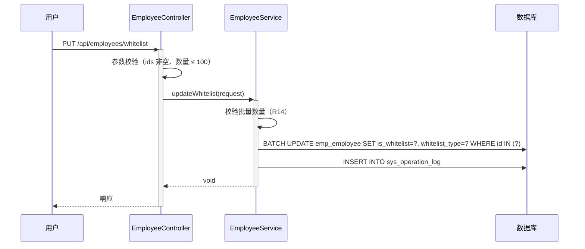

**业务规则：**

| 规则编号 | 规则描述 | 校验时机 | 不满足时的处理 |
|----------|----------|----------|--------------|
| R14 | 单次批量操作 ≤ 100 条 | 操作前 | 返回 EMP_005 |
| R15 | 设置白名单时必须指定类型 | 操作前 | 返回参数校验错误 |
| R16 | 取消白名单时类型自动清空 | 操作时 | 自动处理 |

**并发控制：**
- 并发场景：多人同时修改同一员工的白名单状态
- 控制策略：最后写入覆盖（Last Write Wins），白名单标记无严格一致性要求。

---

### 5.5 成本预算模块

#### 5.5.1 表结构设计

##### 5.5.1.1 部门预算表（bgt_department_budget）

| 字段名 | 数据类型 | 约束 | 默认值 | 说明 |
|--------|----------|------|--------|------|
| id | bigint | PK, 自增 | - | 系统自增主键 |
| department | varchar(100) | NOT NULL | - | 部门名称 |
| year | int | NOT NULL | - | 年份 |
| quarter | int | NOT NULL | - | 季度：1-4 |
| budget_amount | decimal(15,2) | NOT NULL | 0 | 预算金额 |
| used_amount | decimal(15,2) | NOT NULL | 0 | 已使用金额 |
| gmt_create | datetime | NOT NULL | CURRENT_TIMESTAMP | 创建时间 |
| gmt_modified | datetime | NOT NULL | CURRENT_TIMESTAMP | 修改时间 |

**索引：**
- UK: `uk_bgt_dept_year_quarter` (department, year, quarter)

##### 5.5.1.2 枚举与常量定义

| 枚举名称 | 取值 | 含义 | 关联字段 |
|----------|------|------|----------|
| Quarter | 1 | 第一季度 | bgt_department_budget.quarter |
| Quarter | 2 | 第二季度 | bgt_department_budget.quarter |
| Quarter | 3 | 第三季度 | bgt_department_budget.quarter |
| Quarter | 4 | 第四季度 | bgt_department_budget.quarter |

#### 5.5.2 接口详细设计

##### W12 预算汇总统计

- **URI**: GET /api/budget/summary
- **描述**: 获取全公司或指定时间范围的预算汇总
- **入参**:

| 参数名称 | 类型 | 是否必填 | 描述 |
|----------|------|----------|------|
| year | Integer | 否 | 年份，默认当前年 |
| quarter | Integer | 否 | 季度，默认当前季度 |

- **出参**:

| 参数名称 | 类型 | 描述 |
|----------|------|------|
| code | String | 结果码 |
| msg | String | 提示信息 |
| data.totalBudget | BigDecimal | 总预算 |
| data.totalUsed | BigDecimal | 总已用 |
| data.usageRate | BigDecimal | 使用率（%） |
| data.departments | Array | 各部门明细 |
| data.departments[].department | String | 部门名称 |
| data.departments[].budgetAmount | BigDecimal | 预算金额 |
| data.departments[].usedAmount | BigDecimal | 已用金额 |
| data.departments[].employeeCount | Integer | 员工人数 |

##### W13 部门预算详情

- **URI**: GET /api/budget/department/{dept}
- **描述**: 获取指定部门的预算详情及员工成本明细
- **入参**:

| 参数名称 | 类型 | 是否必填 | 描述 |
|----------|------|----------|------|
| dept | String | 是 | 部门名称（路径参数） |
| year | Integer | 否 | 年份 |
| quarter | Integer | 否 | 季度 |

- **出参**:

| 参数名称 | 类型 | 描述 |
|----------|------|------|
| code | String | 结果码 |
| data.budgetAmount | BigDecimal | 部门预算 |
| data.usedAmount | BigDecimal | 已用金额 |
| data.employees | Array | 员工成本明细 |

##### W14 成本趋势数据

- **URI**: GET /api/budget/trend
- **描述**: 获取成本趋势数据，用于图表展示
- **入参**:

| 参数名称 | 类型 | 是否必填 | 描述 |
|----------|------|----------|------|
| year | Integer | 否 | 年份 |
| department | String | 否 | 部门（可选，不传则全公司） |

- **出参**:

| 参数名称 | 类型 | 描述 |
|----------|------|------|
| code | String | 结果码 |
| data.trends | Array | 趋势数据 |
| data.trends[].period | String | 时间段（如 2025-Q1） |
| data.trends[].amount | BigDecimal | 成本金额 |
| data.distribution | Array | 人员分布数据 |
| data.distribution[].department | String | 部门 |
| data.distribution[].count | Integer | 人数 |

#### 5.5.3 子功能详细设计

##### 5.5.3.1 预算汇总（F10/F11）

- 处理时序图
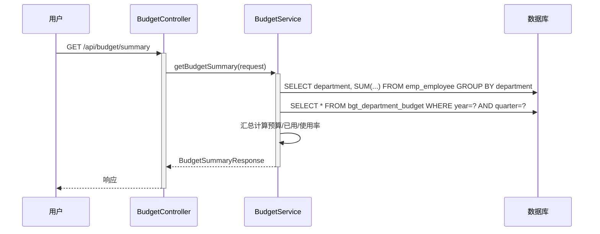

**业务规则：**

| 规则编号 | 规则描述 | 校验时机 | 不满足时的处理 |
|----------|----------|----------|--------------|
| R17 | 已用金额 = 各部门员工（基本工资+社保+公积金+津贴）之和 | 查询时 | 实时计算 |
| R18 | 使用率 = 已用金额 / 预算金额 × 100% | 查询时 | 预算为 0 时显示 N/A |

**并发控制：**
- 并发场景：无写入操作，纯查询
- 控制策略：无并发风险。假设：数据量不大时可考虑缓存，初期直接查库。

---

### 5.6 数据导出模块

#### 5.6.1 表结构设计

本模块无新增表，复用 emp_employee 表数据。

#### 5.6.2 接口详细设计

##### W15 员工数据导出

- **URI**: GET /api/employees/export
- **描述**: 按筛选条件导出员工数据为 Excel 文件
- **入参**:

| 参数名称 | 类型 | 是否必填 | 描述 |
|----------|------|----------|------|
| department | String | 否 | 部门筛选 |
| status | String | 否 | 状态筛选 |
| isWhitelist | Integer | 否 | 白名单筛选 |

- **出参**: Excel 文件流

- **错误码**:

| 错误码 | 说明 |
|--------|------|
| EMP_006 | 导出数据量为空 |

#### 5.6.3 子功能详细设计

##### 5.6.3.1 数据导出（F14）

- 处理时序图
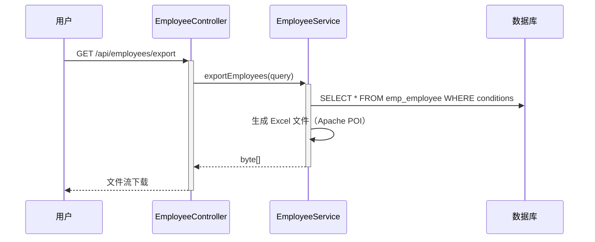

**业务规则：**

| 规则编号 | 规则描述 | 校验时机 | 不满足时的处理 |
|----------|----------|----------|--------------|
| R19 | 导出数据遵循当前用户的权限范围 | 导出时 | 仅导出可见数据 |
| R20 | 敏感字段（手机号、薪资）根据角色决定是否导出 | 导出时 | USER 角色不导出薪资字段 |

---

### 跨模块时序图

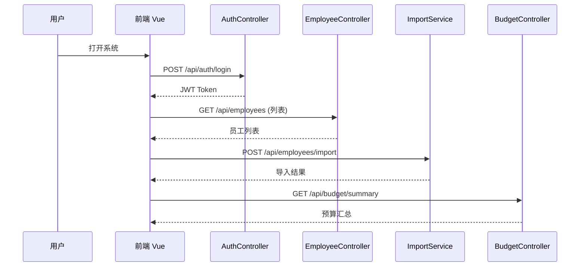

---

## 6. 非功能性需求设计

### 6.1 高可用性

- **应用层**：Spring Boot 无状态设计，支持多实例水平扩展，通过 Nginx 负载均衡分发请求。
- **数据库层**：MySQL 主从架构，主库故障时可手动切换从库（假设：初期不引入自动故障转移，后续可接入 MHA/Orchestrator）。
- **降级策略**：本系统无外部第三方依赖，不存在外部服务降级场景。若数据库不可用，返回 503 错误。

### 6.2 可扩展性

- **水平扩展**：后端应用无状态，可通过增加实例 + Nginx 配置实现水平扩展。
- **垂直扩展**：数据库可通过升级配置提升性能。
- **架构可扩展性**：模块间通过 Service 层调用，新增模块不影响已有模块。未来如需引入 Redis 缓存、MQ 异步处理等，可通过配置化方式接入。

### 6.3 稳定性/可靠性

- **数据一致性**：员工 CRUD 操作使用数据库事务保证一致性。批量导入采用事务批量提交。
- **边界场景**：
  - 导入空文件：返回 IMP_004 错误。
  - 超大文件：文件大小和行数双重限制。
  - 并发导入：数据库唯一约束兜底。
- **数据可靠性**：软删除保证数据可恢复。假设：每日数据库备份。

### 6.4 安全性设计

#### 6.4.1 账户系统方案

自实现登录认证，采用 Spring Security + JWT 方案。密码使用 BCrypt 加密存储。

#### 6.4.2 授权&访问控制

##### 6.4.2.1 水平权限检查

自实现水平权限检查：通过 JWT 中的用户 ID 与资源归属进行校验。员工数据为公共数据，所有登录用户可查看。

##### 6.4.2.2 垂直权限检查

自实现角色权限检查：
- ADMIN：全部接口访问权限
- USER：仅查看类接口 + 导入接口

通过 Spring Security 的 `@PreAuthorize` 注解实现接口级权限控制。

##### 6.4.2.3 登录态检查

全局统一拦截器：所有 `/api/**` 接口（除 `/api/auth/login`）均需 JWT 认证。通过 `JwtAuthenticationFilter` 统一拦截。

#### 6.4.3 数据防护方案

##### 6.4.3.1 敏感数据加密存储

- 密码：BCrypt 加密存储
- 手机号、薪资数据：假设：明文存储（内部系统），后续可按需加密

##### 6.4.3.2 敏感数据展示脱敏

- USER 角色查看员工详情时，薪资字段脱敏显示（如 `****`）
- 手机号中间四位脱敏（如 `138****8000`）
- 日志打印脱敏：密码字段不记录日志

### 6.5 监控/统计/日志/告警

| 监控点 | 说明 | 告警阈值 |
|--------|------|----------|
| API 响应时间 | 所有接口响应耗时 | P99 > 1s |
| 导入接口耗时 | 批量导入处理时间 | > 30s |
| 数据库连接池 | 活跃连接数/最大连接数 | > 80% |
| 错误率 | 5xx 错误占比 | > 1% |
| JVM 内存 | 堆内存使用率 | > 85% |
| 登录失败次数 | 同一用户连续失败 | > 5 次/分钟 |

---

## 7. 变更三板斧

### 7.1 可监控

- **服务埋点**：
  - 各 Controller 接口记录调用次数、成功/失败数、处理耗时
  - 导入接口记录文件大小、行数、成功/失败数、处理耗时
  - 登录接口记录成功/失败数
- **日志规范**：
  - 关键操作写入 sys_operation_log 表
  - 应用日志采用 SLF4J + Logback，按天滚动
- **监控接入**：假设接入 Spring Boot Actuator + Prometheus + Grafana

### 7.2 可灰度

- 本系统为内部管理系统，用户量有限，灰度需求较低。
- 灰度方案：如需灰度，可通过 Nginx 按用户 IP 或 Cookie 分流至新旧版本。
- 数据库变更：新增字段使用 default 值，保证新旧版本兼容。

### 7.3 可应急

- **开关控制**：
  - 批量导入功能可通过配置开关关闭（`app.import.enabled=true/false`）
  - 数据导出功能可通过配置开关关闭
- **回滚方案**：
  - 应用回滚：Docker 镜像版本管理，快速回滚至上一版本
  - 数据库回滚：新增字段/表不影响旧版本运行；删除字段采用软删除方式
- **上下游兼容**：本系统无外部上下游依赖，回滚不影响其他系统

---

## 附录：方案选型决策记录

### 决策 1：认证方案选型

| 方案 | 优点 | 缺点 |
|------|------|------|
| JWT（推荐 ✅） | 无状态、水平扩展友好、实现简单 | 无法主动失效（可通过黑名单解决） |
| Session | 可随时失效 | 有状态、不利于水平扩展 |
| OAuth2 | 标准化、支持第三方 | 实现复杂、本系统无需 |

**推荐**：JWT。理由：内部管理系统，用户量有限，无状态设计简化部署。

### 决策 2：导入处理模式选型

| 方案 | 优点 | 缺点 |
|------|------|------|
| 同步处理（推荐 ✅） | 实现简单、即时反馈 | 大文件时阻塞 |
| 异步+轮询 | 不阻塞、支持大文件 | 实现复杂、需额外状态管理 |

**推荐**：同步处理。理由：文件限制 10MB/5000 行，同步处理可在 30s 内完成，用户体验可接受。后续数据量增长可升级为异步。

### 决策 3：ORM 框架选型

| 方案 | 优点 | 缺点 |
|------|------|------|
| Spring Data JPA（推荐 ✅） | 开发效率高、标准化 | 复杂查询性能调优较难 |
| MyBatis | 灵活、SQL 可控 | 开发量较大 |

**推荐**：Spring Data JPA。理由：本系统 CRUD 为主，查询相对简单，JPA 开发效率高。
